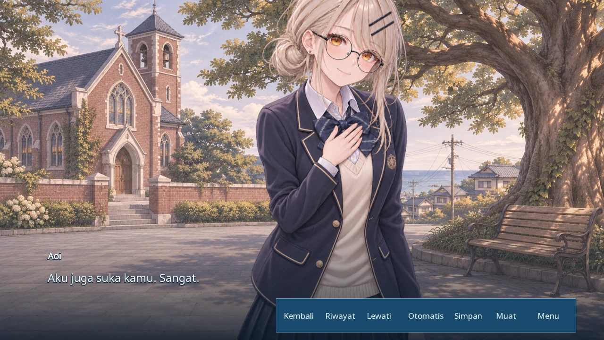
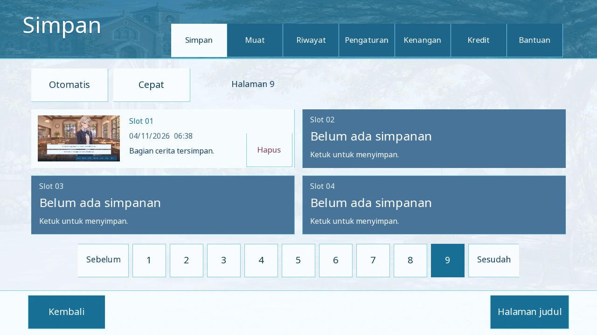

# MADOROMI — Sepuluh Detik

Visual novel romance berbahasa Indonesia, berlatar kota pesisir Jepang yang fiktif. Ren dan Aoi sudah terbiasa mengobrol hingga larut malam. Sebuah pertanyaan sederhana membuat keduanya berhenti selama sepuluh detik—dan mulai memikirkan apa yang ingin mereka katakan.

Cerita utuh dalam **tiga bab, dua belas adegan, dan epilog**, dikembangkan dari naskah asli pengguna. Lima pilihan memengaruhi percakapan dan respons berikutnya, tanpa poin afeksi atau hukuman tersembunyi. Perkiraan durasi baca 40–60 menit; waktu bergantung pada kecepatan membaca.

## Bermain

Unduh [**Madoromi-1.0.0-android.apk** langsung dari GitHub](https://github.com/WynnDev-rill/Visual-Novel-Madoromi-/releases/download/v1.0.0/Madoromi-1.0.0-android.apk) dan [checksum SHA-256](https://github.com/WynnDev-rill/Visual-Novel-Madoromi-/releases/download/v1.0.0/Madoromi-1.0.0-android.apk.sha256). [Halaman release v1.0.0](https://github.com/WynnDev-rill/Visual-Novel-Madoromi-/releases/tag/v1.0.0) sudah diterbitkan. APK versi ini menargetkan Android 16 dan menyertakan ARM64. Salin ke ponsel, buka berkasnya, lalu izinkan pemasangan dari pengelola berkas ketika Android meminta. Game dimainkan secara offline dalam orientasi landscape; minimum Android 5.0 dengan OpenGL ES 3.0. Target pengguna adalah POCO F6/Android 16; pengujian fisik pada ponsel tersebut belum dilakukan di workspace ini.

Ketuk untuk membaca dan pilih jawaban tanpa batas waktu. Tersedia simpan/muat, simpan otomatis native, rollback, riwayat, mode otomatis, lewati, pilihan bab, ukuran teks, pengurangan gerakan, serta pengaturan musik/efek/suasana terpisah. Tidak ada voice acting karakter.

Desktop: ekstrak paket PC, lalu jalankan `Madoromi.exe` di Windows atau `Madoromi.sh` di Linux. Enter/Spasi melanjutkan, Escape membuka menu, Page Up kembali, dan H menyembunyikan antarmuka.

## Presentasi

Referensi UI ATRI dan Please Be Happy yang disediakan melalui Google Drive menjadi dasar revisi tata letak: ilustrasi mendapat ruang lebih besar, dialog ber-outline tanpa panel besar, palet sistem biru-putih, backlog navy, navigasi berbentuk tab, serta tombol yang lebih nyaman disentuh. The NOexistenceN of you AND me menambah referensi ekspresi dan perpindahan komposisi. Ilustrasi, font, musik, dan kode ketiga game tersebut tidak disalin.

Desain Aoi, Mio, Sora, dan Ren mengikuti empat konsep karakter yang disediakan pengguna melalui Drive. Produksi sprite 2D mengembangkan ekspresi, kostum, dan bahasa tubuh sesuai adegan—termasuk gestur gugup, tertawa, berpikir, serta pengakuan perasaan—dengan dissolve dan staging native Ren'Py. Seluruh latar dan prop hadiah diselaraskan menjadi satu gaya ilustrasi 2D buatan AI. Empat musik instrumental berlisensi, ambience, dan efek lembut melengkapi permainan tanpa suara karakter. Ikon aplikasi memakai master pilihan pengguna dari Drive.





Seluruh naskah telah diaudit dan dipoles dengan Creative Writing Skills dari haowjy. Alur asli, lima pilihan, pengakuan timbal balik, pemberian jeans sesudah penerimaan, serta epilog tetap dipertahankan. Rincian revisi tersedia di [audit naskah](docs/STORY_AUDIT.md). Bukti pengujian selalu dibedakan menurut versi build dalam laporan verifikasi.

## Mengembangkan dan membangun

Menggunakan **Ren'Py 8.5.3**, RAPT, JDK 21, dan Android SDK 36. SDK, cache dan kunci signing berada di luar Git.

```bash
tools/build.sh bootstrap
python3 -m pip install Pillow
python3 tests/check_assets.py
tools/build.sh lint
tools/build.sh run
# Mesin Linux tanpa display:
xvfb-run -a tools/build.sh test
tools/build.sh desktop
tools/build.sh bootstrap-android
tools/build.sh android
```

Petunjuk lengkap, dependensi, signing, dan perintah instalasi ADB: [docs/BUILD.md](docs/BUILD.md). Kunci signing pertama disimpan secara privat di direktori toolchain; cadangkan untuk mempertahankan kemampuan memperbarui aplikasi.

## Dokumentasi

- [Desain](docs/DESIGN.md), [naskah dan kontinuitas](docs/STORY.md), [benchmark](docs/BENCHMARKS.md).
- [Hasil verifikasi](docs/VERIFICATION.md) dan [pengujian native](tests/README.md).
- [Skill yang dipakai](docs/SKILLS.md) dan [panduan agen](AGENTS.md).
- [Kredit dan lisensi](THIRD_PARTY_NOTICES.md), [register visual](docs/licenses/visual-art.md), [audio](docs/licenses/audio.md), [font](docs/licenses/fonts.md).

Ilustrasi produksi hasil pengembangan konsep pengguna disimpan di `game/images/originals/`; checkout baru tidak memerlukan pengunduhan paket ilustrasi lama dari itch.io. Referensi sumber privat tetap berada di luar repository. Register akuisisi Potat0Master dipertahankan sebagai riwayat baseline, bukan pilihan aset runtime baru. Hak cerita, konsep karakter, dan ikon sumber tidak digantikan oleh lisensi engine atau skill. Asal serta lingkup dokumentasinya tercatat di [register visual](docs/licenses/visual-art.md) dan [ikon](docs/licenses/icon.md).
